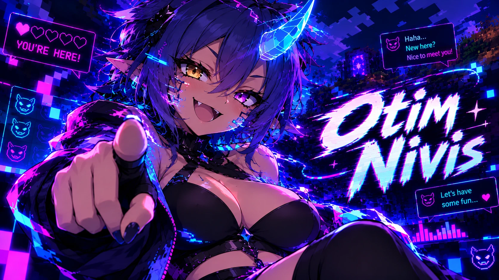
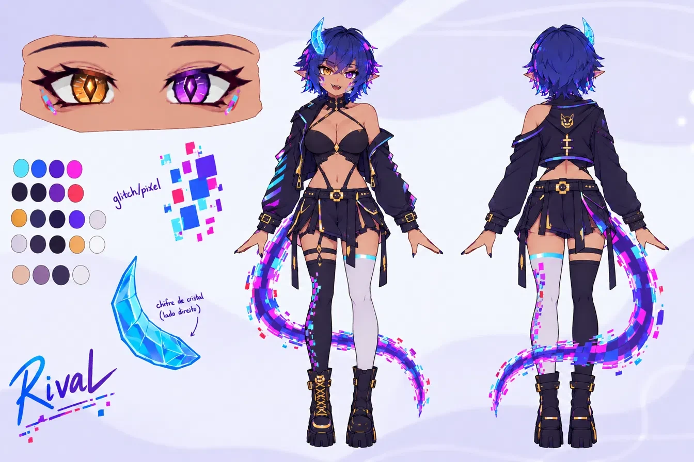

# Otim Nivis — an AI rival that watches you play



> **Status: planning.** No code yet. This repository holds the project plan and the character design; implementation starts at Phase 0 of the [plan](docs/PLAN.md).

Otim Nivis is a program that follows a **Minecraft** session in real time and reacts with short, mocking voice lines, with a simple animated avatar on screen. It is being built from scratch, with the goal of understanding every layer of the system rather than just making it work.

## MVP

Minecraft Java Edition on PC, game events read from the game log, an LLM API generating the line, text-to-speech playing the audio, and a PNG avatar with an animated mouth captured by OBS. All in Python.

Out of the MVP, as optional later phases: vision from screenshots, local models, Live2D, other games, Twitch chat integration and long-term memory.

## Architecture

Five modules in a line, each built in its own phase and connected to the next by a queue or a simple call. The director is the core: it decides *whether* and *when* to speak.

```text
Minecraft (latest.log)
   │  new log lines
   ▼
Event reader     (Phase 1)   tails the log and turns each line into an Event
   │  Event: type, time, data
   ▼
Director         (Phase 2)   queue, priority and cooldown decide if a line is worth saying
   │  speech request with context
   ▼
Brain            (Phase 3)   persona + recent events go to the LLM, which returns the line
   │  line text
   ▼
Voice            (Phase 4)   TTS generates the audio; a speech queue prevents overlap
   │  audio and volume
   ▼
Avatar           (Phase 5)   the mouth follows the audio volume; OBS captures it
```

Configuration, logging and tests cut across every module. Keeping each module behind a small interface is what makes it possible to swap the LLM or the TTS later without rewriting the rest.

## Requirements

| Code | Requirement | Phase |
|---|---|---|
| FR01 | Detect game events: death, damage, system message, advancement, joining the world | 1 |
| FR02 | Represent each event as an object with type, timestamp and data | 1 |
| FR03 | Decide whether and when to speak, with cooldown, priority and a repetition counter | 2 |
| FR04 | Generate a short line with a defined persona and the context of recent events | 3 |
| FR05 | Convert the line to audio and play it without blocking the rest of the program | 4 |
| FR06 | Show an avatar that opens its mouth while the audio plays | 5 |
| FR07 | Read configuration (keys, voice, persona, cooldowns) from a file, without editing code | 2 |
| FR08 | Log everything that was detected, decided and spoken | 1–5 |
| NFR01 | Latency from event to start of audio under 3 s; final target under 1.5 s | 6 |
| NFR02 | Run for 1 hour of gameplay without freezing or leaking memory | 6 |
| NFR03 | No API keys in the repository | 0 |
| NFR04 | API cost below a defined ceiling per hour of gameplay | 3 |
| NFR05 | Swappable modules: change TTS or LLM without touching the rest | 3–4 |
| NFR06 | Automated tests for the parser and the director | 1–2 |

Commits and the README will reference these codes to track what is done.

## Roadmap

| Phase | Deliverable | Status |
|---|---|---|
| 0 — Foundation | package structure, virtual environment, `.gitignore`, `python -m rival` running from a clean clone | planned |
| 1 — Eyes | real-time log reader that turns lines into event objects, with tests | planned |
| 2 — Director | decides when to speak from an event queue, verified by an event simulator | planned |
| 3 — Brain | LLM client with persona and context, cost measured per hour | planned |
| 4 — Voice | non-blocking TTS playback with a speech queue | planned |
| 5 — Body | avatar whose mouth follows the audio's RMS envelope, captured by OBS | planned |
| 6 — Measure and harden | per-stage latency table and a 1-hour run without failures | planned |
| 7 — Expansions | vision, local LLM, Fabric mod, Twitch chat | optional |

Open technical decisions (concurrency model, event source, LLM, TTS, avatar, config format) and the full phase breakdown are in [docs/PLAN.md](docs/PLAN.md).

## Character

The AI has its own original character: **Otim Nivis**, a corrupted program that learned to talk by watching someone play. Smug, sarcastic and quick to comment on every mistake, but secretly invested in the player.

Her look follows a digital/glitch theme: a translucent cyan crystal horn, mismatched amber and purple eyes, glitch pixels on the skin and a dragon tail made of pixel segments that break apart at the edges.



The design is still being refined.

## Stack (planned)

Python 3.11+ · pytest · an LLM API (provider to be decided) · a TTS engine (to be decided) · OBS · Minecraft Java Edition. Developed on Windows and tested on Linux.
